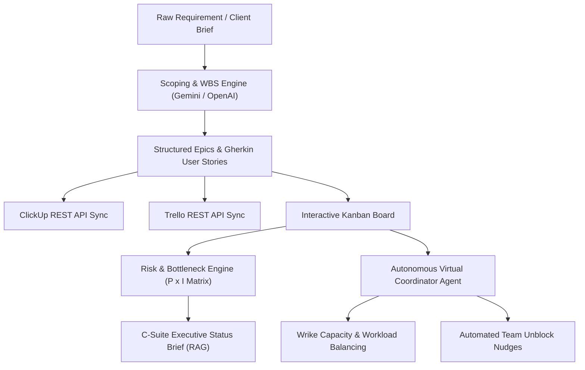

# 🚀 OmniProject AI: Autonomous Digital Project Coordinator

[](https://www.python.org/downloads/)
[](https://streamlit.io/)
[](https://coursera.org)

An end-to-end AI-augmented Project Management suite implementing the core tools, workflows, and prompts taught in the **"Managing Projects with AI"** certification by **AI CERTs™** on Coursera.

---

## 🎯 Course Tool Alignment

This project brings together all 3 core pillars from the course syllabus:

| Course Category | Specific Tools Taught | Implemented in OmniProject AI |
| :--- | :--- | :--- |
| **Mainstream PM Suites** | **ClickUp** | REST API v2 sync (Spaces, Lists, Tasks, Priorities, Tags) & Predictive Bottleneck detection. |
| | **Trello** | REST API Kanban sync (Lists, Cards, Story points, Checklists) & Kanban automation rules. |
| | **Wrike** | Workload Balancing & Resource Capacity optimization ($Allocated / Capacity$). |
| | **Hive** | Predictive completion timelines & recurring task generation. |
| **Generative AI Frameworks** | **Context-Rich Prompting** | Dedicated engines for **Project Scoping (WBS)**, **Dynamic Risk Registers**, and **C-Suite Executive Briefs**. |
| **Virtual AI Agents** | **No-Code / Digital Coordinators** | Autonomous agent that audits board health, generates contextual team nudges for blockers, and logs action events. |

---

## 🏗️ Architecture Overview



---

## ✨ Key Features

1. **AI Work Breakdown Structure (WBS) Generator:**
   * Accepts raw, ambiguous requirements and synthesizes complete Epics, User Stories, and **Given-When-Then** Gherkin acceptance criteria with Fibonacci story points.
2. **Interactive ClickUp & Trello Board:**
   * Move tasks across *To Do, In Progress, Blocked, Done* in real-time.
   * 1-Click sync to your live ClickUp list or Trello board (or test via built-in simulation mode).
3. **Dynamic Risk Log & Interactive Heatmap:**
   * Algorithmic Probability (1-5) $\times$ Impact (1-5) matrix with interactive Plotly scatter heatmap.
   * Predictive bottleneck detection flagging blocked cards on the critical path.
4. **Autonomous Digital Project Coordinator (Virtual AI Agent):**
   * Computes team member capacity vs active allocated hours to prevent burnout.
   * Pre-drafts contextual Slack/Email unblock nudges for assignees.
   * Live event stream of automated actions taken by the agent.
5. **C-Suite Executive Status Brief:**
   * Generates instant RAG status (Red, Amber, Green), sprint completion percentages, accomplishments, and leadership escalation briefs.
   * Downloadable as a clean Markdown report.
6. **Zero-Config Offline Mode:**
   * Works out of the box with intelligent fallback data and sample projects (HealthTech Telemedicine & Fintech KYC), or plug in your Gemini/OpenAI key for live LLM generation!

---

## ⚡ Quick Start

### 1. Run the Launch Script
```bash
cd /Users/sunilsaraf/.gemini/antigravity/scratch/ai-project-coordinator
./run.sh
```

Or run via Streamlit directly:
```bash
python3 -m streamlit run app.py
```

The app will open automatically in your browser at `http://localhost:8501`.

---

## 📂 Project Directory Structure

```text
ai-project-coordinator/
├── app.py                      # Main Streamlit Web Application
├── config.py                   # App Configuration & Constants
├── requirements.txt            # Python Dependencies
├── run.sh                      # One-click startup script
├── README.md                   # Complete Documentation
├── PROMPTS_GUIDE.md            # AI CERTs Course Prompt Templates
├── data/
│   └── sample_projects.json    # Preloaded sample projects (Telemedicine & Fintech)
└── modules/
    ├── ai_client.py            # Unified Gemini / OpenAI / Offline Client
    ├── scoping_engine.py       # Scoping & WBS Generator
    ├── risk_engine.py          # Dynamic Risk Register & PxI Heatmap
    ├── executive_brief.py      # C-Suite Status Report Generator
    ├── agent_coordinator.py    # Autonomous Virtual AI Coordinator Agent
    ├── clickup_client.py       # ClickUp v2 REST API Sync
    └── trello_client.py        # Trello REST API Sync
```
